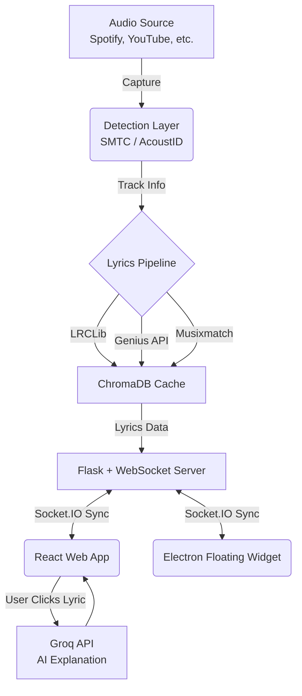

<div align="center">
  <br />
  <h1>🎵 LiveLyrics — Real-Time Lyrics Overlay</h1>
  <p>
    <strong>A production-quality system that detects the currently playing song from ANY app, fetches synchronized lyrics, and displays them in real-time.</strong>
  </p>
  <p>
    <em>Features AI explanations, 12-language translation, and a floating desktop widget. Works with Spotify, YouTube, VLC, Apple Music, Chrome, Edge, and any app that plays audio!</em>
  </p>
  <p>
    
    
    
    
    
  </p>
</div>

---

## 🚀 Quick start (macOS & Windows)

```bash
# 1. Backend
cd backend
python3 -m venv .venv
.venv/bin/pip install -r requirements.txt        # Windows: .venv\Scripts\pip ...
cp .env.example .env                             # all keys optional

# 2. Frontend (build once; the backend serves it at http://localhost:5000)
cd ../frontend && npm install && npm run build

# 3a. Web app:      cd backend && .venv/bin/python app.py   → open http://localhost:5000
# 3b. Desktop widget (starts the backend for you):
cd ../electron && npm install && npm start
```

**Detection:** macOS reads Spotify / Apple Music directly (and YouTube in Chrome-family browsers; enable
*View → Developer → Allow JavaScript from Apple Events* for exact position). Windows uses SMTC.
Optional fingerprint fallback: `brew install chromaprint blackhole-2ch` + `ACOUSTID_API_KEY`.

**Widget:** drag the top bar, resize with the corner grip, `Cmd/Ctrl+Shift+L` show/hide,
`Cmd/Ctrl+Shift+K` click-through lock, tray menu for more.

---

## Installers (macOS .dmg, Windows .exe)

Each installer bundles the app, the lyrics engine and your icon. Users need nothing else installed.

```bash
cd frontend && npm ci && npm run build                     # 1. web UI
cd ../backend && pip install -r requirements.txt -r requirements-build.txt
python -m PyInstaller livelyrics-backend.spec --noconfirm  # 2. standalone backend
cd ../electron && npm ci && npm run dist:mac               # 3. -> electron/release/LiveLyrics-*.dmg
#                                  npm run dist:win        #    -> electron/release/LiveLyrics Setup *.exe  (run on Windows)
```

A Windows installer must be built on Windows. The workflow in `.github/workflows/build-installers.yml`
builds the `.exe` and both Mac `.dmg` files for you on GitHub (Actions tab, "Run workflow").

Unsigned builds show a one-time warning: on macOS right-click the app and choose Open; on Windows choose
"More info", then "Run anyway". Optional API keys (Groq etc.) live in the app's Settings, "API keys".

---

## ✨ Features

LiveLyrics provides a premium karaoke-like experience directly on your desktop, powered by intelligent audio recognition and AI.

- 🎧 **Universal Hybrid Detection**: Captures audio regardless of the source. Uses Windows SMTC (System Media Transport Controls) metadata and AcoustID audio fingerprinting to identify the track accurately.
- 🎤 **Perfectly Synced Lyrics**: Experience real-time lyric scrolling. Aggregates from LRCLib, Genius, and Musixmatch to ensure accurate timings.
- 🎨 **Immersive Viewing Modes**: 
  - **Spotify Mode**: Keeps the active line centered while gently fading the surrounding lines.
  - **Karaoke Mode**: Word-level highlighting with a smooth animated sweep that follows the song's beat.
- 🧠 **AI-Powered Explanations**: Ever wondered what a lyric means? Click on any line to get instant meaning and emotional context powered by Groq (llama3-70b).
- 🌍 **Real-Time Translation**: Instantly translate lyrics into 12 different languages without missing a beat.
- 🖥️ **Floating Desktop Widget**: An always-on-top, transparent Electron overlay that lets you sing along without interrupting your workflow. Includes compact and expanded modes.
- 🌓 **Adaptive Theming**: Beautiful Apple-style dark and light modes with buttery smooth transitions.
- ⚡ **Lightning Fast Caching**: Uses ChromaDB to cache lyrics, AI explanations, translations, and listening history, ensuring instant loads on replays.

---

## 🛠 Tech Stack

LiveLyrics is built using a modern, scalable, and highly responsive tech stack, divided into three core components:

### 🐍 Backend (Python)
The engine of LiveLyrics, responsible for capturing audio, identifying songs, fetching lyrics, and powering AI features.
* **Flask & Flask-SocketIO**: Provides a robust REST API and real-time bidirectional WebSocket communication.
* **SoundDevice & PyAcoustID**: Captures raw system audio via WASAPI loopback and generates fingerprints for track identification.
* **ChromaDB**: An ultra-fast vector database used to locally cache lyrics and AI generations.
* **Groq SDK**: Powers the lightning-fast AI lyric explanations using open-source LLMs.

### ⚛️ Frontend (React)
A sleek, modern web interface that renders the lyrics and provides a highly interactive user experience.
* **React 18 & Vite**: Ensures a lightning-fast development environment and optimized production build.
* **TailwindCSS**: Provides highly customizable, utility-first styling for our beautiful UI.
* **Framer Motion**: Delivers the smooth, fluid animations used for lyric scrolling and karaoke sweeps.
* **Zustand**: A small, fast, and scalable state-management solution to handle the app's complex UI state.

### 🪟 Desktop Widget (Electron)
A seamless desktop integration for users who want lyrics on top of their other applications.
* **Electron**: Wraps the frontend into a lightweight, frameless, and transparent always-on-top desktop widget.

---

## 🏗 Architecture Workflow



---

## 🚀 Quick Start

### Prerequisites

- **Python 3.10+**
- **Node.js 18+**
- **Windows 10/11** (Required for SMTC metadata + WASAPI audio loopback)
- **fpcalc.exe** in the project root (Download from [Chromaprint](https://acoustid.org/chromaprint))

### 1. Backend Setup

Open a terminal and set up the Python environment:

```bash
cd backend
pip install -r requirements.txt
```

Create a `backend/.env` file with your API keys:

```env
ACOUSTID_API_KEY=your_key_here
GROQ_API_KEY=your_key_here
GENIUS_ACCESS_TOKEN=your_token_here   # optional, but recommended
```

Start the core server:

```bash
python app.py
```

### 2. Frontend Setup

Open a new terminal for the React app:

```bash
cd frontend
npm install
npm run dev
```

Navigate to **http://localhost:5173** in your web browser to view the main application.

### 3. Floating Widget (Optional)

If you want the always-on-top desktop experience, open a third terminal:

```bash
cd electron
npm install
npm start
```

---

## 📁 Project Structure

```text
live-lyrics-app/
├── backend/
│   ├── app.py                  # Core Flask + SocketIO server
│   ├── config.py               # Environment configuration
│   ├── audio_capture/          # WASAPI loopback capture modules
│   ├── recognition/            # SMTC + AcoustID detection logic
│   ├── lyrics/                 # API integrations (LRCLib, Genius, Musixmatch)
│   ├── groq_explain/           # AI lyric explanation service
│   ├── translation/            # MyMemory translation service
│   ├── cache/                  # ChromaDB persistent caching
│   └── websocket/              # Event bus & synchronization engine
├── frontend/
│   └── src/
│       ├── components/         # Modular React UI components
│       ├── hooks/              # Zustand store & Socket.IO hooks
│       └── App.jsx             # Main application entry
├── electron/
│   ├── main.js                 # Electron shell configuration
│   ├── preload.js              # IPC bridge for security
│   └── widget.html             # Floating widget container UI
└── README.md
```

---

## 🔑 API Keys Guide

To unlock the full potential of LiveLyrics, you'll need a few free API keys:

| Service | Purpose | How to get it |
|---------|---------|---------------|
| **AcoustID** | Crucial for identifying songs from raw audio fingerprints when metadata isn't available. | [Register at acoustid.org](https://acoustid.org/) |
| **Groq** | Powers the lightning-fast AI lyric meaning and emotional explanations. | [Get API Key at console.groq.com](https://console.groq.com/) |
| **Genius** | (Optional) Serves as a reliable fallback for lyrics if LRCLib doesn't have them. | [Create Client at genius.com/api-clients](https://genius.com/api-clients) |

---

## 📄 License

This project is licensed under the **MIT License**. See the LICENSE file for details.
